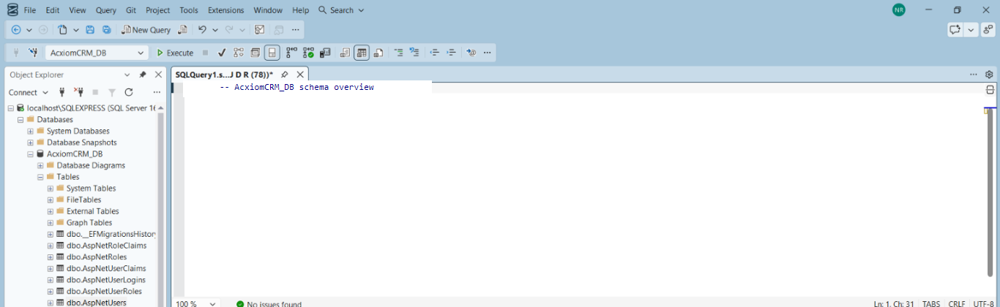

# AcxiomCRM

AcxiomCRM is an ASP.NET Core 9 MVC customer relationship management application backed by SQL Server, Entity Framework Core, and ASP.NET Core Identity. It provides customer and sales-pipeline management for authenticated users.

## Features

- Identity registration, login, logout, remember-me, lockout, password reset/change, email confirmation, and profile management.
- Admin, Manager, and Sales Executive roles, role assignment, account disable/enable, and role-aware record visibility.
- Customer CRUD, duplicate email/phone protection, search, filters, sorting, paging, customer history, CSV and Excel-compatible exports.
- Lead management and lead-to-customer conversion.
- Opportunity management with stage, probability, and weighted pipeline values.
- Follow-up scheduling and completion; completing a follow-up records a CRM activity.
- Activity history for calls, meetings, emails, and tasks.
- Dashboard KPI cards, recent customers and activity, Chart.js city and customer-growth charts.
- Customer, lead, opportunity/pipeline, follow-up, user-activity, and audit reports.
- REST endpoints for customers, leads, opportunities, and follow-ups under `/api`.
- Administrator audit-log search/filtering, anti-forgery protection, validation, structured logging, friendly error handling, and responsive Bootstrap UI.
- Development-only sample customer, lead, opportunity, and follow-up data.

## Requirements Checklist

The following baseline project requirements are implemented:

- [x] ASP.NET Core MVC on .NET 9 with SQL Server and Entity Framework Core.
- [x] ASP.NET Core Identity authentication, account management, role support, and authorization.
- [x] Customer, lead, opportunity, and follow-up management.
- [x] Dashboard with CRM metrics, customer charts, recent customers, and activity.
- [x] Search, filtering, sorting, and pagination for customer records.
- [x] Validation and anti-forgery protection for form submissions.
- [x] Reports with CSV and Excel-compatible exports.
- [x] Responsive Bootstrap interface and authenticated CRM navigation.
- [x] REST API documentation through Development-only Swagger/OpenAPI.
- [x] EF Core migrations and development sample-data seeding.

## Architecture

The application uses ASP.NET Core MVC controllers and Razor Pages for Identity. Domain operations are implemented in service classes and use repository interfaces backed by Entity Framework Core. `ApplicationDbContext` extends `IdentityDbContext`; ASP.NET Core Identity handles password hashing, sign-in, lockout, claims, and role management.

CRM records created by Sales Executives are assigned to their creator. Sales Executives can view their own and unassigned records; Managers and Admins can view all records. This version does not model manager teams separately.

## Folder Structure

```text
Areas/Identity/Pages/   Identity account, profile, and password pages
Controllers/            MVC and REST API controllers
Data/                   DbContext and development data seeder
Interfaces/             Repository and service contracts
Migrations/              EF Core migrations and model snapshot
Models/                  CRM entities, enums, and view models
Repositories/             EF Core repository implementations
Services/                 Customer, CRM, dashboard, report, audit, and SMTP services
Views/                    MVC Razor views
wwwroot/                  Static assets, Bootstrap, and application styles/scripts
```

## Database Setup

1. Install the .NET 9 SDK and SQL Server.
2. Set `ConnectionStrings__DefaultConnection` to the target database. The default development connection targets `localhost\SQLEXPRESS` and `AcxiomCRM_DB`.
3. Apply migrations:

   ```powershell
   dotnet ef database update
   dotnet ef migrations list
   ```

4. The application creates the required CRM roles on startup. It does not insert a default administrator password.

## SMTP Configuration

Configure these environment variables for email confirmation and password reset:

| Variable | Required | Default |
|---|---:|---|
| `Email__SmtpHost` | Yes | — |
| `Email__SenderAddress` | Yes | — |
| `Email__SmtpPort` | No | `587` |
| `Email__EnableSsl` | No | `true` |
| `Email__Username` | No | — |
| `Email__Password` | No | — |

Store credentials in environment variables or a secret provider, not in source control. Email confirmation is disabled in Development and required outside Development.

## Default Login

There is no hard-coded demo login. To bootstrap an administrator securely, set both `BootstrapAdmin__Email` and `BootstrapAdmin__Password` before starting the application. The password must satisfy the configured Identity password policy. Remove or unset these variables after the administrator has been created.

In Development, newly registered users are confirmed automatically and assigned the Sales Executive role. Development sample CRM records are seeded without a demo user.

## How to Run

```powershell
dotnet restore
dotnet ef database update
dotnet build
dotnet run
```

Open the HTTPS URL printed by ASP.NET Core. Production cookies require HTTPS. The EF migration list can be checked with `dotnet ef migrations list`; migrations can be checked for model drift with `dotnet ef migrations has-pending-model-changes`.

### REST API

Swagger UI is enabled only in the Development environment. Start the application with `ASPNETCORE_ENVIRONMENT=Development` and open `/swagger` on the local application URL. The OpenAPI document is available at `/swagger/v1/swagger.json`.

The API is documented with `Swashbuckle.AspNetCore`; endpoints are grouped by controller and include summaries, request/response schemas, and documented status codes. Swagger UI displays request duration and enables Try it out.

Available endpoints:

```text
GET             /api/customers
GET             /api/customers/{id}
POST            /api/customers
PUT             /api/customers/{id}
DELETE          /api/customers/{id}
GET / POST      /api/leads
GET / PUT / DELETE /api/leads/{id}
POST            /api/leads/{id}/convert
GET / POST      /api/opportunities
GET / PUT / DELETE /api/opportunities/{id}
GET / POST      /api/followups
GET / PUT / DELETE /api/followups/{id}
```

The API reuses ASP.NET Core Identity cookie authentication; it does not use bearer tokens. Sign in through the MVC login page in the same browser before calling protected endpoints from Swagger UI. Same-origin requests send the authentication cookie automatically. For POST, PUT, and DELETE requests, include the `RequestVerificationToken` header with the request token rendered in a signed-in MVC form; the browser sends the corresponding antiforgery cookie. Swagger is not exposed outside Development.

## Screenshots

### SQL Server database



The screenshot shows the `AcxiomCRM_DB` database and its CRM and Identity tables in SQL Server Management Studio. Query results are intentionally excluded so that account credentials and customer contact details are not published.

## Technologies Used

- .NET 9 / ASP.NET Core MVC and Razor Pages
- ASP.NET Core Identity
- Entity Framework Core 9
- SQL Server
- Swashbuckle.AspNetCore (Swagger/OpenAPI)
- Bootstrap 5 and Bootstrap Icons
- Chart.js
- HTML, CSS, and JavaScript

## NuGet Packages

- `Microsoft.AspNetCore.Identity.EntityFrameworkCore` 9.0.11
- `Microsoft.AspNetCore.Identity.UI` 9.0.11
- `Microsoft.EntityFrameworkCore.Design` 9.0.11
- `Microsoft.EntityFrameworkCore.SqlServer` 9.0.11
- `Microsoft.EntityFrameworkCore.Tools` 9.0.11
- `Microsoft.VisualStudio.Web.CodeGeneration.Design` 9.0.11
- `Swashbuckle.AspNetCore` 10.3.1

## Known Limitations

- Manager access is application-wide; there is no separate team hierarchy or tenant boundary.
- The APIs use Identity cookies and antiforgery tokens rather than bearer-token authentication. Swagger UI is available only in Development.
- The Excel-compatible report is SpreadsheetML with an `.xls` download extension; there is no native `.xlsx` or PDF export.
- SMTP delivery depends on an externally configured SMTP service; email-dependent flows cannot deliver messages until it is configured.
- The assignment PDF's supplied acceptance walkthrough ends after anonymous-route protection and registration/login to the dashboard. Additional end-to-end acceptance steps were not specified in the document.

## Future Improvements

- Add explicit teams and manager-to-team ownership rules.
- Add a token-based API authentication option if non-browser API clients are required.
- Add native `.xlsx` and PDF report generation.
- Add invitation workflows, automated follow-up reminders, and configurable audit retention.
- Add automated integration tests covering SQL Server migrations, Identity flows, CRUD, authorization, and API responses.
